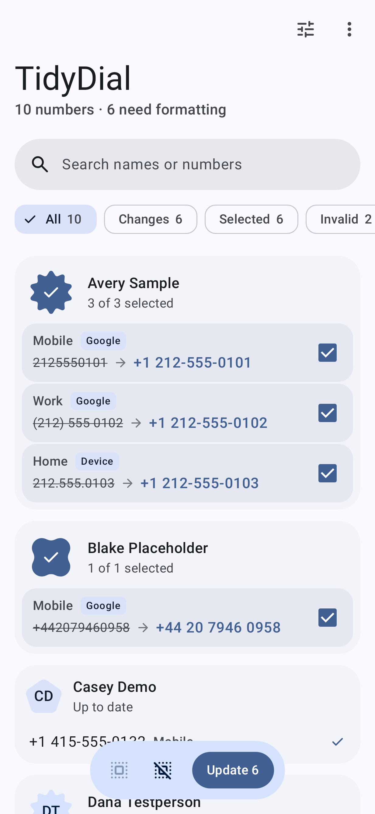
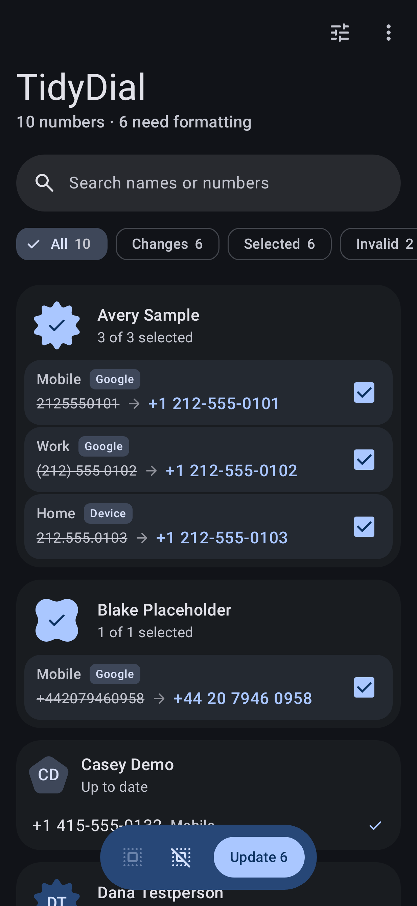
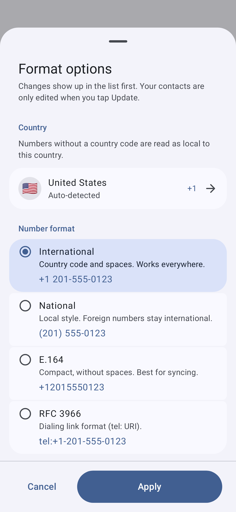
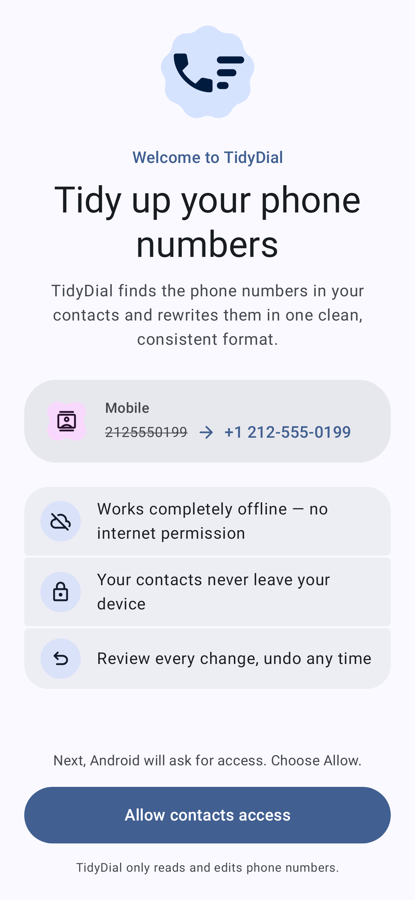
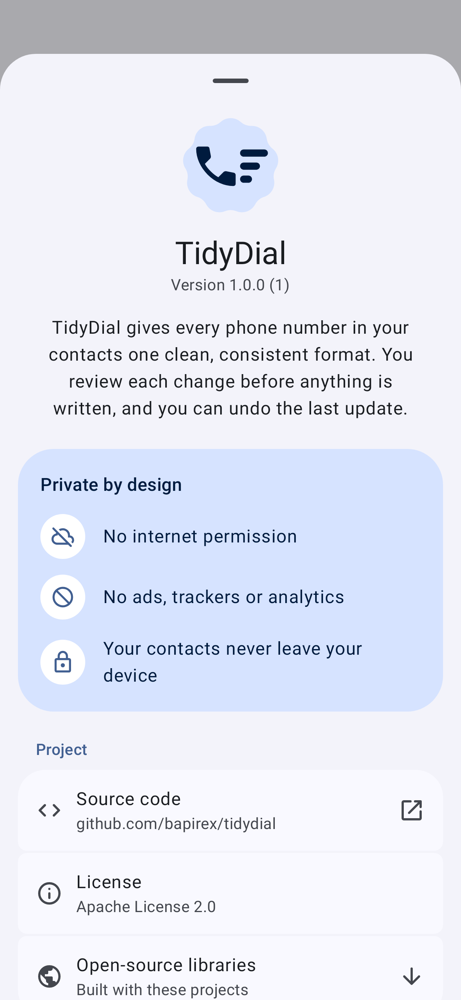

<p align="center">
  
</p>

<h1 align="center">TidyDial</h1>

<p align="center">
  <b>Give every phone number in your Android contacts one clean, consistent format, fully offline.</b>
</p>

<p align="center">
  <a href="LICENSE"></a>
  <a href="#privacy"></a>
  <a href="#building-from-source"></a>
</p>

TidyDial reads the phone numbers in your address book, shows you how each one would look in the
format you choose, and rewrites only the numbers you approve. Parsing and formatting are done
on the device with Google's [libphonenumber](https://github.com/google/libphonenumber).

## Features

- **Four number formats.** Pick the style that suits you. Example for `2125550199` with the
  country set to United States:

  | Format        | Result                  | Notes                                          |
  | :------------ | :---------------------- | :--------------------------------------------- |
  | International | `+1 212-555-0199`       | Country code and separators; works everywhere. |
  | National      | `(212) 555-0199`        | Local style; foreign numbers stay international. |
  | E.164         | `+12125550199`          | Compact, no spaces; good for syncing.          |
  | RFC 3966      | `tel:+1-212-555-0199`   | Dialing-link (`tel:` URI) format.              |

  The options sheet shows a live example for the selected country and format.
- **Region detection.** Numbers without a country code are read as local to your country. TidyDial
  detects it from the SIM, then the mobile network, then the system locale. You can change it
  any time in a searchable country picker.
- **Review before anything is written.** Numbers are grouped by contact, and each row shows
  `before → after`. Filter the list by *All*, *Changes*, *Selected* or *Invalid*, or search by
  name or number.
- **Selective update.** Tick single numbers, tap an avatar to select a whole contact, or use
  *Select all shown*. Contacts change only after you tap **Update** and confirm. Only the number
  field is rewritten. Names, photos and other details stay as they are.
- **Safe writes.** An update is applied only if the number in your contacts still matches what
  TidyDial read. A number edited somewhere else in the meantime is skipped, not overwritten.
- **Undo.** The last update can be undone from the snackbar or the menu, even after the app
  restarts. A number you have edited again since the update is kept, not reverted.
- **Account skipping.** Numbers are labeled by the account that stores them (Google, device, SIM
  card and so on). Accounts that messaging apps sync (WhatsApp, Telegram, Signal, Viber, Threema,
  Skype, Facebook) are skipped by default, because those apps overwrite edits with their own
  copy. You can include or skip each account yourself.
- **Short and emergency numbers protected.** Emergency numbers such as `112` or `911`, short
  service numbers, and USSD codes such as `*#06#` are never changed.
- **Extensions kept.** Dial sequences after a pause (`,`) or wait (`;`) are kept. You can make
  them all use *Wait* or *Pause*, or leave each number's own delimiter. `p` and `w` are converted
  to `,` and `;`.
- **Only valid numbers are rewritten.** Numbers libphonenumber cannot recognize are flagged as
  invalid and left as they are.
- **Material You and Material 3 Expressive.** Built with Jetpack Compose and Material 3
  Expressive. It uses dynamic color on Android 12+ and has a light and a dark theme, edge-to-edge
  layout and a themed launcher icon.

## Privacy

| | |
| :--- | :--- |
| **Internet access** | None. `INTERNET` and `ACCESS_NETWORK_STATE` are removed from the merged manifest, even if a library asks for them. |
| **Ads, trackers, analytics** | None. No proprietary SDKs, no telemetry, no crash reporting. |
| **Where your data goes** | Nowhere. Contacts are read and edited in place through Android's contacts provider and never leave the device. |
| **Stored by the app** | Your format settings and a journal of the last update (for undo). |
| **Backups** | The undo journal holds phone numbers, so it is excluded from cloud backup (and from all backups on Android 11 and lower). |
| **Permissions** | Contacts (`READ_CONTACTS`, `WRITE_CONTACTS`) is the only permission you are asked for. |

See [PRIVACY.md](PRIVACY.md) for the full privacy policy.

## Screenshots

<p>
  
  
  
  
  
</p>

The screenshots are rendered from fake sample contacts by the Roborazzi screenshot tests.

## Building from source

Requirements: **JDK 21** and the Android SDK (compile SDK 37). Gradle is fetched by the
wrapper.

```bash
git clone https://github.com/bapirex/tidydial.git
cd tidydial

./gradlew assembleDebug          # debug APK: app/build/outputs/apk/debug/
./gradlew testDebugUnitTest      # unit and Robolectric tests
./gradlew recordRoborazziDebug   # re-record screenshots into app/src/test/screenshots/
./gradlew verifyRoborazziDebug   # compare against the recorded screenshots
./gradlew lintDebug              # Android lint
./gradlew assembleRelease        # minified release APK (unsigned)
```

The debug build has the application ID `org.tidydial.debug`, so it can be installed next to a
release build (`org.tidydial`).

## Project structure

```text
app/src/main/java/org/tidydial/
├── App.kt                    Application class and a small manual dependency container
├── data/
│   ├── ContactsRepository.kt Reads phone rows, applies and restores changes in batches
│   ├── PhoneNumberFormatter.kt libphonenumber wrapper (formats, extensions, short numbers)
│   ├── CountryCatalog.kt     Supported regions with localized names and calling codes
│   ├── SettingsRepository.kt DataStore-backed settings and country detection
│   └── UndoJournal.kt        Atomic JSON journal of the last update
├── model/                    Plain data classes (PhoneEntry, ContactGroup, FormatConfig, ...)
└── ui/
    ├── MainActivity.kt, MainViewModel.kt, TidyDialApp.kt, UiState.kt
    ├── permission/           Contacts permission explainer
    ├── contacts/             Contact list, filters, toolbar, confirm and progress sheets
    ├── options/              Format options and country picker sheets
    ├── about/                About sheet with licenses
    ├── components/           Shared composables (logo)
    └── theme/                Material 3 Expressive theme, colors, shapes, type
app/src/test/                 JVM, Robolectric and Roborazzi screenshot tests
app/src/test/screenshots/     Reference screenshots
docs/logo.svg                 Logo used in this README
fastlane/metadata/android/    Store listing (F-Droid / fastlane format)
```

## Contributing

Bug reports, translations and pull requests are welcome. Please read
[CONTRIBUTING.md](CONTRIBUTING.md) first. In short:

- Keep the app offline. Do not add the `INTERNET` permission or any tracking, analytics or
  proprietary dependency.
- Run `./gradlew testDebugUnitTest lintDebug verifyRoborazziDebug` before you open a pull
  request. If a UI change is intended, re-record the screenshots with `recordRoborazziDebug` and
  include them in the PR.
- Put all user-facing text in `app/src/main/res/values/strings.xml`.

## Historical inspiration

TidyDial is inspired by an earlier, long-unmaintained contacts formatter for Android. It was
written from scratch as free and open-source software.

## License

```text
Copyright 2026 TidyDial Contributors

Licensed under the Apache License, Version 2.0 (the "License");
you may not use this file except in compliance with the License.
You may obtain a copy of the License at

    http://www.apache.org/licenses/LICENSE-2.0

Unless required by applicable law or agreed to in writing, software
distributed under the License is distributed on an "AS IS" BASIS,
WITHOUT WARRANTIES OR CONDITIONS OF ANY KIND, either express or implied.
See the License for the specific language governing permissions and
limitations under the License.
```

Third-party components and their licenses are listed in [NOTICE](NOTICE).
